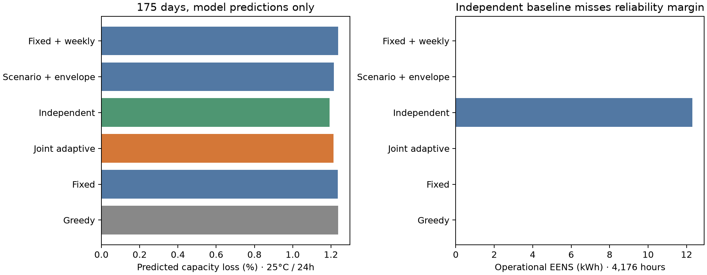
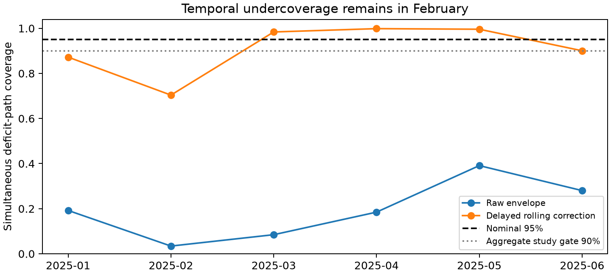

# Degradation-aware adaptive-reserve MPC: frozen 2025 results

**Conclusion: no robust matched-reliability ageing superiority is established.** The computational study is complete; empirical battery applicability and IEEE novelty are not established. Further SAC training remains paused.

## Test and data

The fresh holdout is January 1–June 24, 2025: 4,200 hours, including a common final 24-hour recharge-only normalization day. Operational reliability uses 4,176 hours and 58,652.039 kWh demand. All controllers finish at 360 kWh; normalization causes 9.1599 kWh additional unserved demand for every controller, reported separately. Ageing includes all 4,200 hours. The normalization policy is an experimental boundary condition and contributes to the results.

The constructed reference uses Jaisalmer NASA POWER weather and scaled Indian national demand. It is not a measured local microgrid. Training-only scaling gives 95.653 kW PV and 126.764 kW wind; validation selects a 400 kWh / 50 kW battery, 10–90% SOC and 95% charge/discharge efficiencies. Primary-source verification now confirms all 12,984 demand hours in the 2024–2025 workbook against the mirror, publisher SHA-256, units, attribution and CC BY 4.0. Naive timestamp interpretation, earlier mirror provenance, simplified wind conversion and site representativeness remain limitations.

## Frozen comparison

| Controller | Operational EENS (kWh) | Energy LPSP (%) | Predicted capacity loss (%) | Matches greedy reliability |
|---|---:|---:|---:|:---:|
| Greedy reliability reference | 0.000 | 0.0000 | 1.2376 | Yes |
| Tuned fixed-reserve ageing MPC | 0.000 | 0.0000 | 1.2360 | Yes |
| Joint adaptive-reserve ageing MPC | 0.000 | 0.0000 | 1.2140 | Yes |
| Independent adaptive reserve (primary comparator) | 12.308 | 0.0210 | 1.1934 | No |
| Scenario MPC + matched envelope | 0.000 | 0.0000 | 1.2148 | Yes |
| Tuned fixed reserve + weekly forecast | 0.000 | 0.0000 | 1.2370 | Yes |
| Adaptive, calendar cost removed | 0.000 | 0.0000 | 1.2280 | Yes |
| Adaptive, uncorrected envelope | 739.377 | 1.2606 | 1.0017 | No |
| Point-forecast ageing MPC | 16282.096 | 27.7605 | 0.3640 | No |
| Weekly-forecast ageing MPC | 4665.494 | 7.9545 | 0.6957 | No |
| Scenario ageing MPC | 4017.585 | 6.8499 | 0.7621 | No |

Capacity loss uses the published BLAST-Lite LFP-Gr 250Ah cell model at assumed 25°C with exact effective-age integration and 24-hour updates. These are predictions, not measured loss or lifetime extension. Reliability matching requires both daily and weekly paired block-bootstrap upper EENS bounds within 0.01 percentage points of energy LPSP, plus equal terminal inventory.

Joint adaptive reserve predicts **1.78% lower loss than tuned fixed reserve** (1.2140% versus 1.2360% capacity loss), with zero operational EENS for both. The daily paired damage interval excludes zero; the weekly interval includes zero. Therefore this apparent improvement fails the predeclared confidence requirement. The scenario-plus-envelope baseline has nearly identical damage (only 0.067% relative difference), with both damage intervals including zero.

The independently calibrated reserve was the best validation-qualified ageing baseline and was frozen as the **primary comparator**. On the test it predicts lower loss than the proposed method but incurs 12.308 kWh operational EENS, exceeding the 5.865 kWh matching margin. The primary comparison therefore does not establish matched reliability or an ageing benefit. The primary comparator is retained rather than replaced after inspecting the test. Low-damage point/scenario policies have much worse reliability and cannot support an ageing benefit claim.

Paired intervals resample frozen hourly damage increments in 24/168-hour blocks, 1,000 replicates. They describe conditional variability within this constructed episode; they do not include cell-parameter uncertainty or represent independent site replications. See [machine-readable comparisons](docs/evidence/age_mpc_v2/matched_reliability.json) and [claim gates](docs/evidence/age_mpc_v2/claim_gates.json).

## Calibration and forecast findings

The revised sampler preserves synchronized seasonal/day-phase residual trajectories, enforces PV/wind nameplate limits and physical night masking, and avoids division by collapsing forecast interval widths. A delayed rolling score corrects every contiguous DC-deficit interval across the next 23 hours. This calibrates an envelope, not the joint probabilities of the draws.

Fresh-test simultaneous coverage rises from **19.34% raw to 91.26% corrected**, exceeding the predeclared aggregate 90% gate but missing the nominal 95% target. February coverage is **70.39%**, so temporal calibration remains inadequate under drift. Forecast diagnostics by variable and lead are released separately; marginal intervals are not used as controller safety guarantees. Weekly persistence remains a strong benchmark. No claim of fully calibrated scenarios or learned-forecast superiority is made.

## Battery verification and sensitivity

The implementation preserves upstream parameter/reference compatibility and adds analytic power-law integration checks, physical action projection, strict energy accounting, and source-specific temperature/rate guards. Published model parameters are unchanged. Sensitivities cover 25/35°C and 12/24/48-hour updates. Every primary adaptive evaluation window falls below the source model's 0.8–1 fitted DOD range: **100% are extrapolated**. Numerical verification is not pack validation. A different shallow-cycle-validated LFP model or independent cell/pack measurements are required before interpreting these numbers as physical ageing benefits.

Frozen-policy daily capacity-fade feedback also ran at 25°C and 35°C, preserving SOC and explicitly accounting for lost stored energy. Greedy and joint adaptive retain zero operational EENS; independent reserve incurs 12.679/12.922 kWh. These are model sensitivities, not extra confirmatory tests or new parameter selection. All six runs restore the maximum inventory of their remaining capacity. A NumPy-boolean JSON serialization failure was corrected in a separate wrapper without changing frozen simulation source or numerical outputs.

## Reproducibility and research decision

Full primary and capacity-feedback hourly traces, calibration records, registry metadata, frozen source archive, parameter receipt, package versions and SHA-256 inventory are committed in [the evidence directory](docs/evidence/age_mpc_v2/README.md). [Protocol](docs/degradation_mpc_protocol.md), [data/model validation](docs/age_mpc_validation.md), and [reproduction commands](docs/age_mpc_reproduction.md) explain the implementation and limits. Earlier results remain historical evidence.

Do not spend further SAC compute or claim IEEE-level novelty from this experiment. The next confirmatory study needs an independently sourced hourly Indian site load, measured or validated generation conversions, a shallow-cycle-applicable LFP model, drift-aware calibration developed without reusing this holdout for confirmation, and multiple untouched seasons/sites. The useful result here is a reproducible, guarded comparison with a negative/inconclusive superiority finding.
